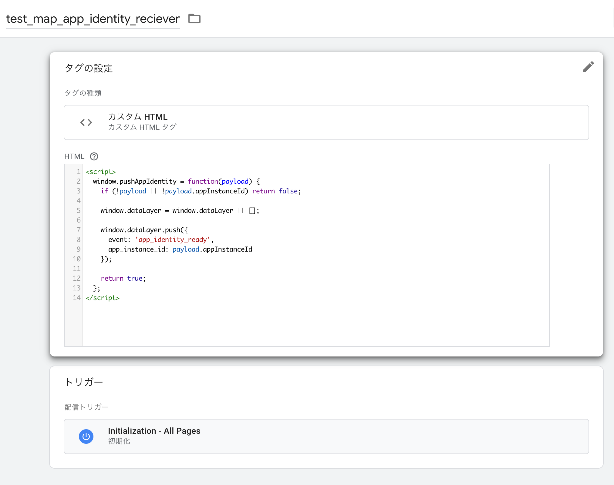
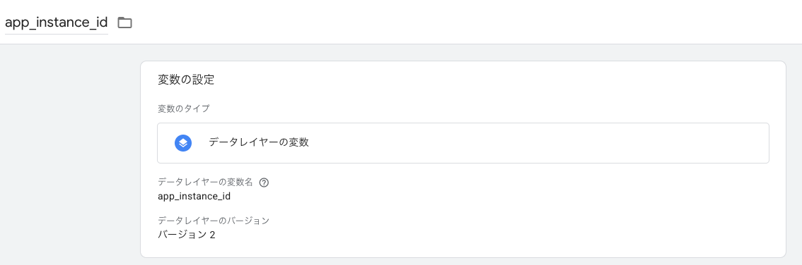
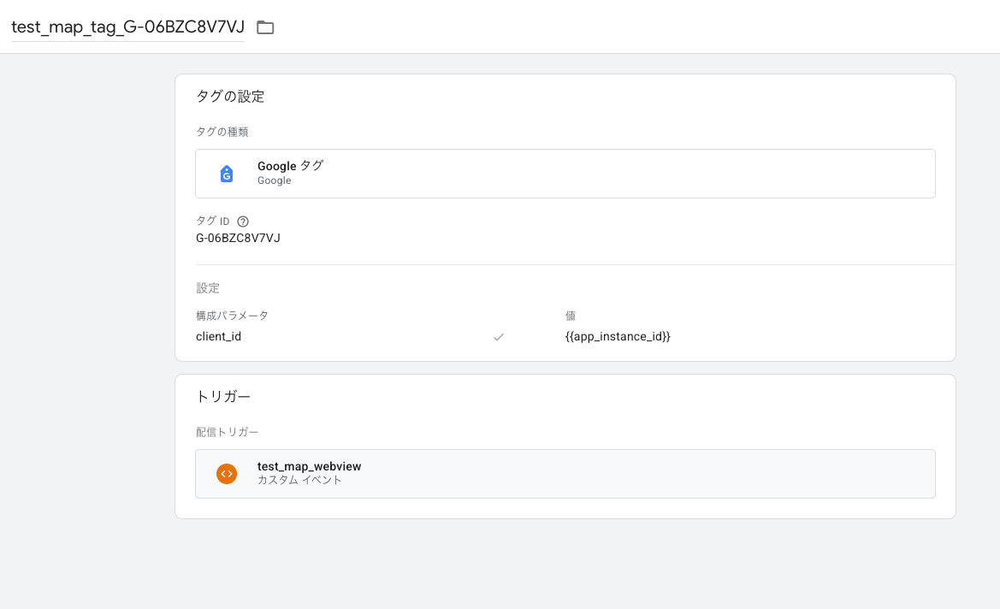
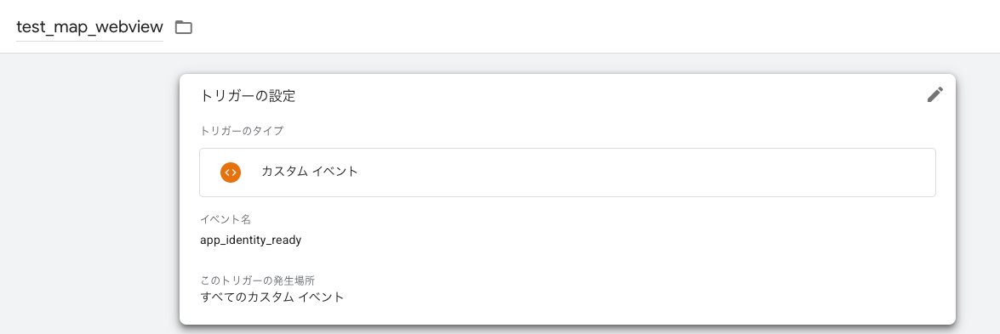
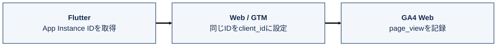
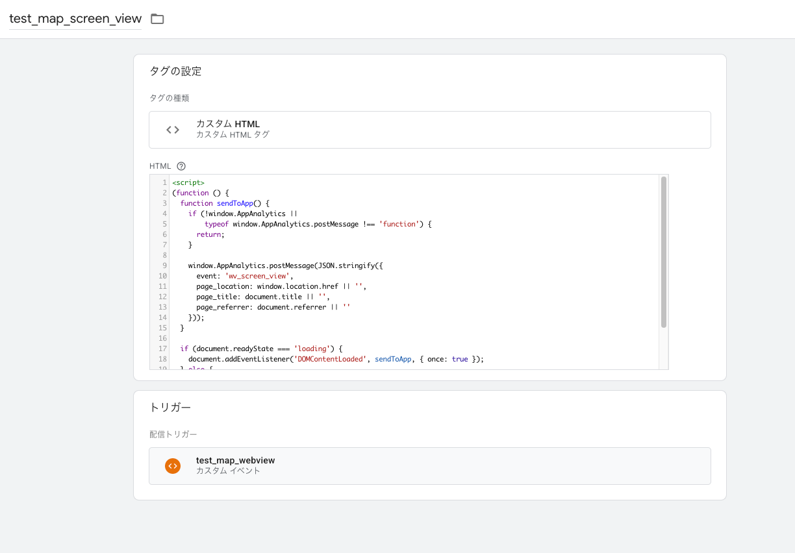

# Flutter + iOS + WebView：GA4計測の実務マニュアル

**目次**

- [0. 確認した環境と前提](#section-0)
- [1. Apple・Flutter Plugin・自作コードの役割](#section-1)
  - [1.1 AppleのWKWebView](#section-1-1)
  - [1.2 Flutter Plugin](#section-1-2)
  - [1.3 ページ遷移はcallbackで通知される](#section-1-3)
  - [1.4 JavaScript Channelの仕組み](#section-1-4)
  - [1.5 2方式の役割の違い](#section-1-5)
- [2. 方式①：Appのapp\_instance\_idをWebのclient\_idとして使う](#section-2)
  - [2.1 目的と完成形](#section-2-1)
  - [2.2 GTM：App Identity Receiver](#section-2-2)
  - [2.3 GTM：データレイヤー変数](#section-2-3)
  - [2.4 GTM：WebView専用Googleタグ](#section-2-4)
  - [2.5 Flutter：App Instance IDを取得する](#section-2-5)
  - [2.6 Flutter：App Instance IDをWebへ渡す処理と、そのタイミング](#section-2-6)
  - [2.7 方式①の全体フロー](#section-2-7)
  - [2.8 方式①の確認済み結果](#section-2-8)
- [3. 方式②：Webページ情報をAppのscreen\_viewとして送る](#section-3)
  - [3.1 目的と完成形](#section-3-1)
  - [3.2 GTM：ページ情報をFlutterへ送るタグ](#section-3-2)
  - [3.3 WebからFlutterへ送るデータ](#section-3-3)
  - [3.4 NavigationDelegate：Pluginの処理とtest_map独自処理の違い](#section-3-4)
  - [3.5 ページの読み込みを見分ける\_documentVersionと二重送信防止](#section-3-5)
  - [3.6 Webから届いたデータをAppAnalyticsで受け取り、内容を確認する](#section-3-6)
  - [3.7 WebViewScreenView：ページ情報をGA4で送れる形に整える](#section-3-7)
  - [3.8 Firebase AnalyticsからAppのscreen\_viewを送る](#section-3-8)
  - [3.9 WebViewを閉じたあと、mapのscreen_viewへ戻す](#section-3-9)
  - [3.10 方式②の全体フロー](#section-3-10)
- [4. 検証方法](#section-4)
  - [4.1 方式①：ID受け渡しとWeb送信](#section-4-1)
  - [4.2 方式②：ページ通知からAppのscreen_viewまで](#section-4-2)
  - [4.3 自動テストと検証範囲](#section-4-3)
- [5. 2方式の比較](#section-5)
  - [5.1 2方式を組み合わせた処理の流れ](#section-5-1)

<a id="section-0"></a>

## 0. 確認した環境と前提

| 項目 | 現在の実値 | 確認元 |
| --- | --- | --- |
| Flutter | 3.47.2 / stable | ローカルSDKの`bin/cache/flutter.version.json`、プロジェクトの`.dart_tool/package_config.json` |
| Dart | 3.13.2 | 同SDK情報の`dartSdkVersion`、package_configの`generatorVersion` |
| iOS Deployment Target | 15.0 | `ios/Podfile`とXcodeプロジェクトのDebug／Profile／Release設定 |
| CocoaPods | 1.16.2 | `pod --version`の実行結果、`ios/Podfile.lock` |
| firebase_core | 4.14.0 | `pubspec.lock`（pubspecの指定は`^4.14.0`） |
| firebase_analytics | 12.5.0 | `pubspec.lock`（指定は`^12.5.0`） |
| webview_flutter | 4.13.1 | `pubspec.lock`（指定は`^4.10.0`） |
| webview_flutter_wkwebview | 3.25.0 | `pubspec.lock`（指定も`3.25.0`固定） |
| Firebase iOS SDK / Analytics | 12.18.0 | `ios/Podfile.lock` |

Dartのpubspec制約`^3.9.2`は許容範囲であり、実行環境の3.13.2とは区別します。iOS 15.0はアプリの最低対応OSで、検証端末のOSバージョンを表す値ではありません。

参照ファイル：[pubspec.yaml:29](/Users/masatosakaguchi/Desktop/untitledfolder/test_map/pubspec.yaml:29), [pubspec.lock:100](/Users/masatosakaguchi/Desktop/untitledfolder/test_map/pubspec.lock:100), [Podfile:1](/Users/masatosakaguchi/Desktop/untitledfolder/test_map/ios/Podfile:1), [project.pbxproj:489](/Users/masatosakaguchi/Desktop/untitledfolder/test_map/ios/Runner.xcodeproj/project.pbxproj:489), [Podfile.lock:18](/Users/masatosakaguchi/Desktop/untitledfolder/test_map/ios/Podfile.lock:18)

本文では、AppはFlutterアプリ、WebViewはアプリ内でWebページを表示する部分を指します。GA4へ記録する画面の閲覧イベントを`screen_view`、Webページの閲覧イベントを`page_view`と呼びます。

前提となる現行構成：

- `main()`で`Firebase.initializeApp()`を完了してからアプリを起動する。[main.dart:15](/Users/masatosakaguchi/Desktop/untitledfolder/test_map/lib/main.dart:15)
- iOSの`FirebaseAutomaticScreenReportingEnabled`は`false`。画面のscreen_viewはアプリから明示的に送る。[Info.plist:27](/Users/masatosakaguchi/Desktop/untitledfolder/test_map/ios/Runner/Info.plist:27)
- `FirebaseAnalyticsObserver`の登録はない。
- 計測対象はページ全体が再読み込みされるWebサイト。SPA専用の表示検知は今回の構成に含めない。
- 初期表示先は`https://corp.ex-ture.com/`。WebとFlutterの間でデータをやり取りする仕組み（Bridge）で許可するWebサイトの範囲（origin：通信方式・ホスト名・ポート番号の組み合わせ）は`https://corp.ex-ture.com`と`https://ex-ture.com`。[webview_screen_view.dart:6](/Users/masatosakaguchi/Desktop/untitledfolder/test_map/lib/services/webview_screen_view.dart:6)

この文書は、test_mapで現在使っているGA4計測の仕組みと設定、確認済みの結果を記録したものです。

### この文書の読み方

1. 第1章でApple／Plugin／アプリの役割を押さえる。
2. 第2章でAppのIDをWebへ渡す方式①を理解する。
3. 第3章でWebページ情報をAppへ返す方式②を理解する。
4. 第4章でtest_mapの現在の動作を検証する。
5. 第5章で2方式の目的と送信先を比較し、組み合わせた処理全体を確認する。

コードリンクは現在の作業環境でのファイルの場所（絶対パス）と、該当するコードが始まる行番号です。処理の場所を確認できるよう、各リンクにファイル名とクラス・関数名を併記します。掲載するDartコードは現行ソースの抜粋、GTMのHTMLは提供された全文です。

<a id="section-1"></a>

## 1. Apple・Flutter Plugin・自作コードの役割

<a id="section-1-1"></a>

### 1.1 AppleのWKWebView

iOSでWebページを表示する仕組みが、WebKitの`WKWebView`です。HTMLを読み、JavaScriptを実行し、Webページを描画し、リンク先への移動やページ読み込みを実際に行う本体です。FlutterがHTMLを独自に描画しているわけではありません。

<a id="section-1-2"></a>

### 1.2 Flutter Plugin

FlutterからiOSなどの機能を使えるようにする追加部品をPluginと呼びます。操作を呼び出すための決められた窓口がAPIです。

| 要素 | 所属 | 役割 |
| --- | --- | --- |
| `webview_flutter` 4.13.1 | Flutter Plugin | Dartから利用する共通APIを提供する |
| `webview_flutter_wkwebview` 3.25.0 | Flutter PluginのApple実装 | 共通APIとWKWebViewの操作・通知を接続する |
| `WebViewController` | PluginのAPI | URL読み込み、JavaScript実行、Channel登録、NavigationDelegate設定を行う窓口 |
| `WebViewWidget` | PluginのWidget | Controllerが管理するネイティブWebViewをFlutter画面へ配置する |
| `NavigationDelegate` | PluginのAPI | ページ読み込み・遷移判断・エラー等をDartのcallbackへ通知する |
| `AppAnalytics` | test_mapが決めた名前 | `addJavaScriptChannel()`で登録するChannel名。Apple標準名ではない |
| `_documentVersion` | test_mapが管理する番号 | ページの読み込みごとに増える番号。今処理しているデータが現在表示中のページのものかを見分けるために使う。WKWebViewやFlutterが発行した文書IDではない |
| `WebViewScreenView` | test_mapの自作クラス | 通知内容を検証・整形し、Analytics用の値を作る |

```text
FlutterアプリのDartコード
    ↓ WebViewControllerなどの共通API
webview_flutter
    ↓ iOS向け実装
webview_flutter_wkwebview
    ↓ ネイティブAPI
Apple WKWebView / WebKit
    ↓
HTML・JavaScript・描画・ページ読み込み
```

<a id="section-1-3"></a>

### 1.3 ページ遷移はcallbackで通知される

ページの読み込み開始などをきっかけに呼ばれる処理をcallbackと呼びます。ページ側からの通知に応じて、Flutterの処理が動きます。

```text
ユーザーがリンクを押す
    ↓
WKWebViewがNavigationを開始
    ↓ WKNavigationDelegateのdidStartProvisionalNavigation
webview_flutter_wkwebview
    ↓
NavigationDelegate.onPageStarted(url)
    ↓
test_mapのcallback本体
    ↓
_documentVersion++ とWebから届くデータを処理できる状態かどうかを更新
```

導入済みPluginでは`didStartProvisionalNavigation`を`onPageStarted`へ、`didFinishNavigation`を`onPageFinished`へ転送しています。**FlutterがURLを定期的にポーリングして遷移を探している構成ではありません。** アプリ内の`currentUrl()`呼び出しは、WebからFlutterへデータが届いたときなどに現在のURLを検証するための一時的な照会です。

Plugin実装の参照：[webview_flutter_wkwebview 3.25.0：1196行](/Users/masatosakaguchi/.pub-cache/hosted/pub.dev/webview_flutter_wkwebview-3.25.0/lib/src/webkit_webview_controller.dart:1196)

<a id="section-1-4"></a>

### 1.4 JavaScript Channelの仕組み

WebのJavaScriptからFlutterへ文字列を送るための仕組みがJavaScript Channelです。

アプリが`AppAnalytics`を登録すると、iOS側Pluginはページの読み込み開始時に`window.AppAnalytics`からWebKitのmessage handlerへ接続するJavaScriptを注入します。`postMessage()`の文字列はWebKitの`WKScriptMessageHandler`を経てDartの`onMessageReceived`へ届きます。

```text
GTMのJavaScript
    ↓ window.AppAnalytics.postMessage(JSON文字列)
WKWebView / WebKit message handler
    ↓ webview_flutter_wkwebview
JavaScript Channel（webview_flutterのAPI）
    ↓ onMessageReceived
Flutter / Dart
    ↓
webview_page.dartのアプリ独自処理
```

Pluginの登録処理：[webview_flutter_wkwebview 3.25.0：473行](/Users/masatosakaguchi/.pub-cache/hosted/pub.dev/webview_flutter_wkwebview-3.25.0/lib/src/webkit_webview_controller.dart:473)。Dart callbackへ渡す処理：[webview_flutter_wkwebview 3.25.0：1013行](/Users/masatosakaguchi/.pub-cache/hosted/pub.dev/webview_flutter_wkwebview-3.25.0/lib/src/webkit_webview_controller.dart:1013)。アプリが任意に決めるのはChannel名と受信後の処理です。

test_mapの`_loadPage()`は、JavaScript Channelの登録が完了してからWebページを読み込みます。これにより、ページ読み込み直後にWebからデータが送られてもFlutterで受け取れる状態にします。[webview_page.dart:382](/Users/masatosakaguchi/Desktop/untitledfolder/test_map/lib/pages/05_webview/webview_page.dart:382)

<a id="section-1-5"></a>

### 1.5 2方式の役割の違い

2方式の共通の最終目的は、**AppとWebViewを分断せず、GA4上で同一ユーザーの一連の行動として分析できるようにすること**です。そのために、2方式はそれぞれ異なる役割を担います。

**方式①：「誰なのか」をそろえる**

AppのFirebase Analytics SDKが持つ`app_instance_id`を、Web側Googleタグの`client_id`として使用します。たとえばAppが`app_instance_id = ABC`なら、Webも`client_id = ABC`となるようにします。Web側では、このIDを使って通常のWeb `page_view`をWebストリームへ送信します。

これは、**AppとWebで同じID文字列を使い、同じユーザーとして分析できるようにするための方式**です。test_mapでは、GA4のセグメント重複で「iOSユーザー：1」「iOS + Web：1」「iOSのみ：0」を確認しています。検証条件と結果は[2.8 方式①の確認済み結果](#section-2-8)を参照してください。同じID文字列を使っても、AppストリームとWebストリームは別のままです。

**方式②：「何を見たのか」をApp側にも記録する**

WebView内のページ情報をFlutterへ送り、Appストリームへ`screen_view`として記録します。たとえば`/case`の閲覧では、イベント名が`screen_view`、`screenName`が`web:/case`になります。このイベントはAppのFirebase Analytics SDKから送るため、App側SDK自身のApp Instance IDを使います。

これは、**WebView内のページ閲覧も、そのAppユーザーの一連の行動として記録するための方式**です。

**方式① = 「誰なのか」をそろえる。方式② = 「何を見たのか」をApp側にも記録する。** 2方式は競合する方式ではなく、**組み合わせて使用します**。

- 方式①：Flutter → Web / GTM → GA4 Web
- 方式②：Web / GTM → Flutter → GA4 App

[2.7](#section-2-7)と[3.10](#section-3-10)では、それぞれの方式の流れを簡潔にまとめています。2方式を組み合わせた詳細な処理の流れは[第5章の5.1](#section-5-1)で確認できます。

<a id="section-2"></a>

## 2. 方式①：Appのapp_instance_idをWebのclient_idとして使う

<a id="section-2-1"></a>

### 2.1 目的と完成形

AppのFirebase Analytics SDKが持つApp Instance IDをWebへ渡し、WebView専用Googleタグの`client_id`として使います。

| 計測先 | 使用するID | 記録するイベント |
| --- | --- | --- |
| Appストリーム（iOS） | SDK管理の`app_instance_id` | 既存Appイベント |
| Webストリーム | 同じID文字列を設定した`client_id` | 通常のWeb `page_view` |

**同じID文字列を使っても、WebストリームとAppストリームは別のままです。** WebイベントをAppストリームへ移し替える方式ではありません。

<a id="section-2-2"></a>

### 2.2 GTM：App Identity Receiver

Web上の計測用コード（タグ）を管理するのがGTMです。以下のReceiverは、FlutterからApp Instance IDを受け取る処理です。GTMにデータを渡すための置き場所をdataLayerと呼びます。

| 設定 | 確定値 |
| --- | --- |
| タグ名 | `test_map_app_identity_reciever` |
| タグ種類 | カスタム HTML |
| 配信トリガー | `Initialization` |

GTM：App Identity Receiverの設定画面



このReceiverは`Initialization`で発火し、Webページ側に`window.pushAppIdentity`関数を先に定義します。その後Flutterから`pushAppIdentity(payload)`が呼ばれると、`app_identity_ready`とApp Instance IDがdataLayerへpushされます。

タグ名の`reciever`は提供された実際の綴りをそのまま使用します。コード全文：

```html
<script>
  window.pushAppIdentity = function(payload) {
    if (!payload || !payload.appInstanceId) return false;

    window.dataLayer = window.dataLayer || [];

    window.dataLayer.push({
      event: 'app_identity_ready',
      app_instance_id: payload.appInstanceId
    });

    return true;
  };
</script>
```

| コード | 意味 |
| --- | --- |
| `window.pushAppIdentity` | 現在のWebページに、Flutterから呼べる関数を定義する |
| `payload` | Flutterが引数として渡すオブジェクト |
| `payload.appInstanceId` | そのオブジェクトから取り出すSDK由来のID文字列 |
| 冒頭の`if` | 引数またはIDがなければ受け取り失敗として`false`を返す |
| `window.dataLayer = window.dataLayer || []` | 既存のdataLayerを維持し、なければ配列を作る |
| `dataLayer.push(...)` | GTMが利用するデータとイベントをdataLayerへ追加する |
| `event: 'app_identity_ready'` | IDが利用可能になったことをGTMへ知らせるカスタムイベント |
| `app_instance_id` | dataLayerへ保存するキー名。値は`payload.appInstanceId` |
| `return true` | Flutterへ受け取り処理の成功を返す |

つまり、**Flutterから渡されたApp Instance IDを、GTMが利用できるdataLayerへ格納する**関数です。この関数の実行だけでGoogleタグの送信が完了したことにはなりません。

Flutterは追加で`skipIfAlreadySent: true`も引数に含めますが、掲載のReceiverはこの項目を参照しません。App Instance IDをWebへ渡す通常の処理で、二重送信を防ぐ役割はFlutterの`_identitySent`／`_identityInFlight`が担います。Receiver自身は、呼ばれれば毎回dataLayerへpushするコードです。

<a id="section-2-3"></a>

### 2.3 GTM：データレイヤー変数

| 設定 | 確定値 |
| --- | --- |
| 変数名 | `app_instance_id` |
| 変数タイプ | データレイヤーの変数 |
| データレイヤーの変数名 | `app_instance_id` |
| データレイヤーのバージョン | バージョン 2 |
| デフォルト値 | なし |

GTM：app_instance_idデータレイヤー変数



```text
dataLayerに格納したapp_instance_id
    ↓ GTMのデータレイヤー変数が読む
GTM変数 app_instance_id
    ↓ タグ内での参照記法
{{app_instance_id}}
```

GTM変数がIDを新しく生成するのではなく、Flutterから受け取った文字列を読み出します。

<a id="section-2-4"></a>

### 2.4 GTM：WebView専用Googleタグ

| 設定 | 確定値 |
| --- | --- |
| タグ名 | `test_map_tag_G-06BZC8V7VJ` |
| タグタイプ | Google タグ |
| タグID | `G-06BZC8V7VJ` |
| 構成パラメータ | `client_id` |
| 値 | `{{app_instance_id}}` |
| 配信トリガー名 | `test_map_webview` |
| トリガータイプ | カスタム イベント |
| カスタムイベント名 | `app_identity_ready` |

GTM：WebView専用Googleタグのclient_id設定



GTM：test_map_webviewトリガーのapp_identity_ready設定



```text
app_identity_ready
    ↓
{{app_instance_id}}の値を取得
    ↓
Googleタグ：client_id = {{app_instance_id}}
    ↓
Webストリーム G-06BZC8V7VJ
    ↓
通常のWeb page_view
```

<a id="section-2-5"></a>

### 2.5 Flutter：App Instance IDを取得する

コード：[app_instance_id_service.dart:5](/Users/masatosakaguchi/Desktop/untitledfolder/test_map/lib/services/app_instance_id_service.dart:5)

クラス：なし（トップレベル関数）／関数：`getAppInstanceId()`

```dart
Future<String?> getAppInstanceId({Future<String?> Function()? readId}) async {
  try {
    final String? id =
        await (readId ?? () => FirebaseAnalytics.instance.appInstanceId)();
    if (id == null || id.trim().isEmpty) {
      if (kDebugMode) {
        debugPrint(
          'app_instance_id unavailable: SDK returned null/empty (check Analytics consent/collection)',
        );
      }
      return null;
    }
    if (kDebugMode) {
      debugPrint('app_instance_id acquisition succeeded: $id');
    }
    return id;
  } catch (error) {
    if (kDebugMode) debugPrint('app_instance_id acquisition failed: $error');
    return null;
  }
}
```

本番の取得元は`FirebaseAnalytics.instance.appInstanceId`です。`readId`はテスト時の差し替え口です。SDKの値を都度読み、独自に永続保存しません。null・空白だけの値・取得例外はnullとして扱い、無効なIDをWebへ渡しません。

<a id="section-2-6"></a>

### 2.6 Flutter：App Instance IDをWebへ渡す処理と、そのタイミング

以下のクラスは、すべて`webview_page.dart`の`_WebViewPageState`です（Provider定義のみ`WebViewPage`）。

| コード | 関数・プロパティ | 処理内容 |
| --- | --- | --- |
| [webview_page.dart:16](/Users/masatosakaguchi/Desktop/untitledfolder/test_map/lib/pages/05_webview/webview_page.dart:16) | `WebViewPage.appInstanceIdProvider` | 既定の取得関数を`getAppInstanceId`にする |
| [webview_page.dart:56](/Users/masatosakaguchi/Desktop/untitledfolder/test_map/lib/pages/05_webview/webview_page.dart:56) | `_notifyAppIdentity()` | ID取得、画面の状態とページの読み込み番号の確認、WebへのJavaScript実行、成功状態の記録 |
| [webview_page.dart:88](/Users/masatosakaguchi/Desktop/untitledfolder/test_map/lib/pages/05_webview/webview_page.dart:88) | 同関数内の`runJavaScriptReturningResult()` | `window.pushAppIdentity(payload)`を呼び、戻り値を確認 |
| [webview_page.dart:113](/Users/masatosakaguchi/Desktop/untitledfolder/test_map/lib/pages/05_webview/webview_page.dart:113) | `_onIdentityRequest()` | 要求時点の現在表示しているURL、許可origin、userinfoなし、ページの読み込み番号を確認 |
| [webview_page.dart:311](/Users/masatosakaguchi/Desktop/untitledfolder/test_map/lib/pages/05_webview/webview_page.dart:311) | `onMessageReceived` | `app_identity_request`文字列をID要求処理へ振り分ける |
| [webview_page.dart:49](/Users/masatosakaguchi/Desktop/untitledfolder/test_map/lib/pages/05_webview/webview_page.dart:49) | `didChangeDependencies()` | `ModalRoute.isCurrentOf(context)`で表示状態を更新し、条件がそろっていればApp Instance IDをWebへ渡す |
| [webview_page.dart:329](/Users/masatosakaguchi/Desktop/untitledfolder/test_map/lib/pages/05_webview/webview_page.dart:329) | `onPageStarted` | ページの読み込み番号を増やし、App Instance IDをWebへ渡したかどうかの記録をリセット |
| [webview_page.dart:346](/Users/masatosakaguchi/Desktop/untitledfolder/test_map/lib/pages/05_webview/webview_page.dart:346) | `onPageFinished` | WebからIDの要求がなくても、読み込み完了後にApp Instance IDをWebへ渡す予備の処理 |

WebへのJavaScript実行部分（現行コード）：

```dart
      final String origins = jsonEncode([
        Uri.parse(firebaseHostingWebUrl).origin,
        ..._analyticsAllowedOrigins.map((uri) => uri.origin),
      ]);
      final String encodedId = jsonEncode(id);
      final Object pushed = await _controller.runJavaScriptReturningResult('''
        (function () {
          if ($origins.includes(window.location.origin) &&
              typeof window.pushAppIdentity === 'function') {
            return window.pushAppIdentity({appInstanceId: $encodedId, skipIfAlreadySent: true}) === true;
          }
          return false;
        })()
      ''');
```

`jsonEncode(id)`でIDをJavaScript文字列として安全に組み込みます。Web側の`window.location.origin`も照合し、`pushAppIdentity`が関数として存在する場合だけ実行します。導入済みPluginの`runJavaScriptReturningResult()`はWKWebViewの`evaluateJavaScript()`を呼び出します。[webview_flutter_wkwebview 3.25.0：578行](/Users/masatosakaguchi/.pub-cache/hosted/pub.dev/webview_flutter_wkwebview-3.25.0/lib/src/webkit_webview_controller.dart:578)

App Instance IDをWebへ渡す処理には、次の条件があります。

- Flutterの画面がまだ存在し（mounted）、現在の画面（Route）が表示されており、読み込みエラーがないこと。
- 通常は、DOMが利用でき、ページの読み込みが完了していることを確認する。Webから`app_identity_request`を受けた場合は、この待機条件だけを省略する。
- ID取得前にページの読み込み番号を保存し、取得後にページの読み込み番号・表示状態を再確認する。
- `_identityInFlight`を使い、App Instance IDをWebへ渡す処理が同時に重複して動くのを防ぐ。
- JavaScript結果が成功で、ページの読み込み番号も変わっていなければ`_identitySent = true`にする。
- 同じページを再表示したりcallbackが複数回呼ばれたりしても、App Instance IDをWebへ渡す処理が成功済みなら繰り返さない。新しい`onPageStarted`でリセットするため、同じURLを再読み込みした場合はApp Instance IDをWebへ再び渡せる。

`onPageFinished`では、条件がそろっていればApp Instance IDをWebへ渡します。毎回必ず再送するわけではありません。関数がまだない場合などは成功扱いにせず、後続の要求・表示変更・読み込み完了のタイミングで再試行できます。定期ポーリングはありません。

`app_identity_request`を受ける入口はFlutterコードに存在します。Web側から明示要求がなくても`onPageFinished`の経路は利用できます。提示されたReceiverコード自体には要求を送る行はありません。

<a id="section-2-7"></a>

### 2.7 方式①の全体フロー

**方式①：誰なのかをそろえる**



AppとWebで同じID文字列を使うことで、同じユーザーとして分析できるようにします。AppストリームとWebストリーム自体は別のままです。

<a id="section-2-8"></a>

### 2.8 方式①の確認済み結果

以下はユーザー提供の実機・GA4検証結果です。今回この文書作成時に再計測した数値ではありません。

| Web送信項目 | 確認済み内容 |
| --- | --- |
| `en` | `page_view` |
| `tid` | `G-06BZC8V7VJ` |
| `cid` | App Instance IDと同じ値 |
| `dl` | 実際のWeb URL |
| HTTP status | 204 |

GA4のセグメント重複でも、次の結果を確認済みです。

| 区分 | ユーザー数 |
| --- | ---: |
| Webユーザー | 20 |
| iOSユーザー | 1 |
| Webのみ | 19 |
| iOSのみ | 0 |
| iOS + Web | 1 |

この検証条件では、**テストiOSユーザー1人がWebユーザーにも含まれる**ことを確認しています。ストリーム自体は別です。この結果だけで、すべての端末・レポートで常に同一ユーザーとして扱われることを保証するものではありません。

<a id="section-3"></a>

## 3. 方式②：Webページ情報をAppのscreen_viewとして送る

<a id="section-3-1"></a>

### 3.1 目的と完成形

WebViewを開いただけでは、WebView全体を1画面として記録する`screen_view`を送らず、表示されたWebページの情報をFlutterで受け取ったときにApp側の`screen_view`を送ります。

```text
Map                    screenName = map
 ↓ WebViewを開く        この操作だけではWebView単位のscreen_viewを送らない
Webトップ表示           screenName = web:/
 ↓
/case表示               screenName = web:/case
 ↓
/reason表示             screenName = web:/reason
 ↓ WebViewを閉じる
Mapへ復帰               screenName = map
```

イベント名はすべて`screen_view`で、上記は`screenName`の値です。方式①の通常Web `page_view`も残します。

<a id="section-3-2"></a>

### 3.2 GTM：ページ情報をFlutterへ送るタグ

| 設定 | 確定値 |
| --- | --- |
| タグ名 | `test_map_screen_view` |
| タグタイプ | カスタム HTML |
| トリガー | `app_identity_ready` |

GTM：ページ情報をFlutterへ送るtest_map_screen_viewタグ



コード全文：

```html
<script>
(function () {
  function sendToApp() {
    if (!window.AppAnalytics ||
        typeof window.AppAnalytics.postMessage !== 'function') {
      return;
    }

    window.AppAnalytics.postMessage(JSON.stringify({
      event: 'wv_screen_view',
      page_location: window.location.href || '',
      page_title: document.title || '',
      page_referrer: document.referrer || ''
    }));
  }

  if (document.readyState === 'loading') {
    document.addEventListener('DOMContentLoaded', sendToApp, { once: true });
  } else {
    sendToApp();
  }
})();
</script>
```

**このJavaScriptはGA4へ直接送信しません。役割はWebページ → Flutterへの情報伝達です。** GA4へAppのscreen_viewを送るのは後段のFlutter／Firebase Analytics SDKです。

| コード・用語 | 意味 |
| --- | --- |
| `(function () { ... })();` | 即時実行関数。定義直後に実行し、内部の関数名をグローバルへ公開しない |
| `sendToApp` | WebからFlutterへデータを送れるか確認し、メッセージを送る関数 |
| `window.AppAnalytics` | Flutterが登録したJavaScript ChannelのWeb側の窓口 |
| `typeof ...postMessage !== 'function'` | 窓口に呼び出し可能なpostMessageがなければ処理を終了する |
| `postMessage(...)` | JSON文字列をFlutterの受信callbackへ渡す |
| `JSON.stringify(...)` | JavaScriptオブジェクトをChannelで渡せるJSON文字列へ変換する |
| `event: 'wv_screen_view'` | Webページの閲覧情報だとFlutterが判断するための値。GA4へ送る最終イベント名ではない。 |
| `window.location.href` | 現在ページのURL。query／fragmentを含む元のURLを渡す |
| `document.title` | 通知時点のページタイトル |
| `document.referrer` | ブラウザが保持する参照元URL。空の場合もある。常に完全な直前URLとは限らない |
| `|| ''` | 値が空などの場合、文字列の空値へそろえる |
| `document.readyState` | DOMの読み込み状態を確認する |
| `'loading'` | まだDOMを構築している状態。この場合はすぐ送らない |
| `DOMContentLoaded` | DOM構築後のイベント。このタイミングでsendToAppを呼ぶ |
| `{ once: true }` | 登録したイベントリスナーを1回実行したら解除する |
| `else { sendToApp(); }` | 既にDOM利用可能な場合は、その場で送る |

`once: true`はそのリスナーの実行回数を制限するものです。タグ自体の重複実行までまとめて防ぐものではないため、Flutterでもページの読み込みごとに二重送信を防ぐ処理を行います。

<a id="section-3-3"></a>

### 3.3 WebからFlutterへ送るデータ

```json
{
  "event": "wv_screen_view",
  "page_location": "https://ex-ture.com/case",
  "page_title": "事例紹介",
  "page_referrer": "https://ex-ture.com/"
}
```

WebからFlutterへ送るのは、上の例にある`event`・`page_location`・`page_title`・`page_referrer`の4項目だけです。`event`には`wv_screen_view`を指定します。

`page_location`・`page_title`・`page_referrer`は、いずれも文字列として送ります。`page_title`と`page_referrer`は空文字でも構いませんが、`page_location`には有効なURLが必要です。閲覧IDやApp Instance IDなどのユーザー識別用IDは、このメッセージには含めません。

<a id="section-3-4"></a>

### 3.4 NavigationDelegate：Pluginの処理とtest_map独自処理の違い

クラス：`_WebViewPageState`／登録関数：`initState()`。[webview_page.dart:318](/Users/masatosakaguchi/Desktop/untitledfolder/test_map/lib/pages/05_webview/webview_page.dart:318)

| callback | Pluginが提供する通知・API | test_mapがcallback内で行う処理 | 実コード |
| --- | --- | --- | --- |
| `onNavigationRequest` | 遷移要求にnavigate／preventを返す窓口 | HTTP／HTTPSを許可し、それ以外を止める。screen_viewは送らない | [webview_page.dart:320](/Users/masatosakaguchi/Desktop/untitledfolder/test_map/lib/pages/05_webview/webview_page.dart:320) |
| `onPageStarted` | iOS側のWebViewから届く読み込み開始の通知 | ページの読み込み番号を増やし、DOMが使える状態か、App Instance IDをWebへ渡したか、ページが読み込み中かを更新する | [webview_page.dart:329](/Users/masatosakaguchi/Desktop/untitledfolder/test_map/lib/pages/05_webview/webview_page.dart:329) |
| `onPageFinished` | iOS側のWebViewから届く読み込み完了の通知 | 読み込み表示を終了し、エラーがなければDOMを使える状態として記録する。条件がそろっていればApp Instance IDをWebへ渡す | [webview_page.dart:346](/Users/masatosakaguchi/Desktop/untitledfolder/test_map/lib/pages/05_webview/webview_page.dart:346) |
| `onWebResourceError` | Webリソースのエラー通知 | WebViewのページ本体（主フレーム）で対象のエラーが起きたら、Webから届くデータの処理を止め、エラー表示へ切り替える | [webview_page.dart:361](/Users/masatosakaguchi/Desktop/untitledfolder/test_map/lib/pages/05_webview/webview_page.dart:361) |

API名とcallbackを呼ぶ仕組みはPluginが提供します。ページの読み込み番号の管理やAnalytics送信判断は、そのcallbackに書いたアプリ独自の処理です。読み込み完了通知自体がscreen_viewを送るわけではありません。

<a id="section-3-5"></a>

### 3.5 ページの読み込みを見分ける_documentVersionと二重送信防止

ページAのデータを処理している途中でページBの読み込みが始まると、ページAの処理が遅れて完了することがあります。その結果をページBの閲覧として誤って記録しないために、`_documentVersion`を使います。

ページの読み込みが始まるたびに、この番号を1増やします。処理開始時に保存した番号と、待っていた処理が終わった時点の番号が違えば、「処理中に別のページの読み込みが始まった」と判断し、古いデータは処理せず無視します。

定義：[webview_page.dart:38](/Users/masatosakaguchi/Desktop/untitledfolder/test_map/lib/pages/05_webview/webview_page.dart:38)／クラス：`_WebViewPageState`。

```dart
int _documentVersion = 0;
int? _screenViewDocumentVersion;
```

`_documentVersion`は`onPageStarted`ごとに増える**test_map独自のページの読み込み番号**です。ネイティブのDocumentオブジェクトIDではありません。次の読み込みが始まったかを、結果を待つ処理（非同期処理）の前後で比較するために使います。

更新箇所：[webview_page.dart:329](/Users/masatosakaguchi/Desktop/untitledfolder/test_map/lib/pages/05_webview/webview_page.dart:329)。結果を待つ受信処理での番号の保存：[webview_page.dart:194](/Users/masatosakaguchi/Desktop/untitledfolder/test_map/lib/pages/05_webview/webview_page.dart:194)。処理後の再確認：[webview_page.dart:237](/Users/masatosakaguchi/Desktop/untitledfolder/test_map/lib/pages/05_webview/webview_page.dart:237)。

```text
受信処理がページの読み込み番号3を保存
    ↓ currentUrl()やdocument.readyStateの結果を待つ
別ページのonPageStarted → 現在のページの読み込み番号4
    ↓ 古い非同期処理が再開
保存した3 != 現在の4
    ↓
古いデータは処理せず無視する
```

同じページ読み込み内での二重送信防止は`_screenViewDocumentVersion`が担当します。[webview_page.dart:271](/Users/masatosakaguchi/Desktop/untitledfolder/test_map/lib/pages/05_webview/webview_page.dart:271)

```dart
        if (page.location != uri ||
            _screenViewDocumentVersion == documentVersion) {
          return;
        }
        // Reserve before awaiting the service: concurrent callbacks share this guard.
        // Do not retry automatically: SDK completion is not a delivery receipt.
        _screenViewDocumentVersion = documentVersion;
        await widget.analyticsService.logWebViewScreenView(page);
```

確認条件を満たしたら、同じページのscreen_viewを二重送信しないよう、SDKへの送信を待つ前に、現在のページの読み込み番号を`_screenViewDocumentVersion`へ送信済みとして記録します。同時に複数の通知が届いても、同じ番号の追加送信を止められます。新しい読み込みで`_documentVersion`が増えると、記録済みの番号とは異なるため、同じURLの再読み込みや`/a → /b → /a`も新しい閲覧として扱います。`_screenViewDocumentVersion`を明示的にnullへ戻す実装ではありません。ここでの「送信済み」は二重送信を防ぐための記録であり、GA4への到着を保証するものではありません。

対象は、アプリが受信処理を開始してから次の読み込みへ移ったケースです。受信前から遅れていた以前のページの通知については、送信元のページを確実に見分けるための印（送信元トークン）がなく、同じURLなら内容だけで区別できない場合があります。現在表示しているURLとの照合はWebView全体に表示しているURLを確認するもので、どの埋め込み領域（frame）が送ったかを証明するものではありません。GTMは現在表示しているページの情報を通知する、という前提です。

<a id="section-3-6"></a>

### 3.6 Webから届いたデータをAppAnalyticsで受け取り、内容を確認する

Webから届くのは、ページのURL・タイトル・参照元などをJSONという形式でまとめた文字列です。Flutterは、内容に必要な項目がそろっているか、現在表示中の許可されたページの情報かを順に確認します。確認条件を満たした場合だけ、Appのscreen_viewとして送る処理へ進みます。

| 順序 | ファイル・クラス・関数 | 内容 |
| --- | --- | --- |
| 1 | [webview_page.dart:302](/Users/masatosakaguchi/Desktop/untitledfolder/test_map/lib/pages/05_webview/webview_page.dart:302) — `_WebViewPageState.initState()`内 | Webから送られた文字列を、既存のAppAnalytics Channelで受け取る。受け取った内容をFlutterの処理へ渡す。 |
| 2 | [webview_page.dart:178](/Users/masatosakaguchi/Desktop/untitledfolder/test_map/lib/pages/05_webview/webview_page.dart:178) — `_WebViewPageState._onAnalyticsMessage()` | JSONを読み取り、必要な項目が入っているか確認する処理を呼ぶ。また、画面がまだ存在するか（mounted）、現在表示中か（Route）、読み込みエラーがないかを確認する。表示していない画面の閲覧を記録しないため。 |
| 3 | [webview_page.dart:141](/Users/masatosakaguchi/Desktop/untitledfolder/test_map/lib/pages/05_webview/webview_page.dart:141) — `_WebViewPageState._parseAnalyticsMessage()` | 届いた文字列をJSONとして読み、event・項目数・値の型を確認する。想定したページ通知かを確かめ、条件を満たしたらURLなどの確認へ進む。 |
| 4 | [webview_screen_view.dart:37](/Users/masatosakaguchi/Desktop/untitledfolder/test_map/lib/services/webview_screen_view.dart:37) — `WebViewScreenView.tryParse()` | URLが有効かを確認し、タイトルを整え、参照元URLも確認する。問題がなければ、URL・タイトル・参照元をまとめたWebViewScreenViewデータを作る。 |
| 5 | [webview_page.dart:197](/Users/masatosakaguchi/Desktop/untitledfolder/test_map/lib/pages/05_webview/webview_page.dart:197) — `_onAnalyticsMessage()`内 | 現在表示しているWebページが許可しているWebサイトかを、通信方式（scheme）・ホスト名（host）・実際に使われるポート番号と許可originを照合して確認する。別サイトの閲覧をAppのscreen_viewとして記録しないため。 |
| 6 | [webview_page.dart:214](/Users/masatosakaguchi/Desktop/untitledfolder/test_map/lib/pages/05_webview/webview_page.dart:214) — 同関数内 | 必要ならdocument.readyStateでページの構造（DOM）が使える状態かを確認する。interactive／completeなら次へ進み、まだ読み込み中のページを記録しない。 |
| 7 | [webview_page.dart:237](/Users/masatosakaguchi/Desktop/untitledfolder/test_map/lib/pages/05_webview/webview_page.dart:237) — 同関数内 | 結果を待っている間にページや画面の状態が変わることがあるため、待機後もページの読み込み番号・表示状態・エラー・originを再確認する。条件を満たした場合だけ次へ進む。 |
| 8 | [webview_page.dart:271](/Users/masatosakaguchi/Desktop/untitledfolder/test_map/lib/pages/05_webview/webview_page.dart:271) — 同関数内 | Webから届いたlocationが現在表示しているURLと一致するか、同じページの読み込み番号で既に送信していないかを確認する。問題がなければ、二重送信を防ぐため、SDKへの送信前に送信済みとして番号を記録する。 |
| 9 | [analytics_service.dart:182](/Users/masatosakaguchi/Desktop/untitledfolder/test_map/lib/services/analytics_service.dart:182) — `FirebaseAnalyticsService.logWebViewScreenView()` | 確認を終えたページ情報をAppのscreen_viewとして送れる形に整え、Firebase Analytics SDKへ渡す。 |

JSONを読み取り、ページのscreen_viewに必要な項目を確認する部分：

```dart
      if (value is Map<String, dynamic> && value['event'] == 'wv_screen_view') {
        if (value.length != 4 ||
            value['page_location'] is! String ||
            value['page_title'] is! String ||
            value['page_referrer'] is! String) {
          return null;
        }
        final page = WebViewScreenView.tryParse(
          pageLocation: value['page_location'] as String,
          pageTitle: value['page_title'] as String,
          pageReferrer: value['page_referrer'] as String,
        );
        return page == null
            ? null
            : (event: 'wv_screen_view', pagePath: null, page: page);
      }
```

検証条件の詳細：

- JSON全体は2048 UTF-16コード単位以内。JSONが壊れている場合や、余分な項目・項目の不足・文字列以外の値がある場合は、その通知を処理せず無視する。
- `page_location`はHTTPSの許可2originのみ。URLにユーザー情報（userinfo）が含まれる場合や、パーセント表記が不正な場合、空白・制御文字等が含まれる場合は、その通知を処理せず無視する。
- referrerが非空なら有効なHTTP／HTTPS URLであることを確認する。外部originも許容する。参照元URLが不正なら、その通知全体を処理せず無視する。
- 現在表示しているURLとの比較には、query／fragmentを含む元の`Uri`を使う。保存用に短縮したURLで比較しない。
- 非表示中、破棄済み、読み込みエラー、DOMがまだloading、ページの読み込み番号が変わった場合は、その通知を処理せず無視する。無視した通知を後で処理するために保存したり、自動で再送したりする仕組みはない。

<a id="section-3-7"></a>

### 3.7 WebViewScreenView：ページ情報をGA4で送れる形に整える

ファイル：[webview_screen_view.dart:3](/Users/masatosakaguchi/Desktop/untitledfolder/test_map/lib/services/webview_screen_view.dart:3)／クラス：`WebViewScreenView`。

| 関数・getter | 実コード | 処理 |
| --- | --- | --- |
| `_parseUrl()` | [webview_screen_view.dart:15](/Users/masatosakaguchi/Desktop/untitledfolder/test_map/lib/services/webview_screen_view.dart:15) | URLを読み取り、通信方式（scheme）、接続先情報（authority）、ホスト名（host）、ユーザー情報（userinfo）、ポート番号（port）などを確認する |
| `tryParse()` | [webview_screen_view.dart:37](/Users/masatosakaguchi/Desktop/untitledfolder/test_map/lib/services/webview_screen_view.dart:37) | ページのURL（location）が許可originに含まれるか確認し、タイトル（title）を整え、参照元URL（referrer）が有効かを確認する |
| `_bounded()` | [webview_screen_view.dart:54](/Users/masatosakaguchi/Desktop/untitledfolder/test_map/lib/services/webview_screen_view.dart:54) | 制御文字を除去し、Unicodeコードポイント単位で最大100文字にする |
| `_boundedUrl()` | [webview_screen_view.dart:58](/Users/masatosakaguchi/Desktop/untitledfolder/test_map/lib/services/webview_screen_view.dart:58) | 短縮後に末尾に残った不完全なパーセントエスケープを除く |
| `_safeUrl()` | [webview_screen_view.dart:61](/Users/masatosakaguchi/Desktop/untitledfolder/test_map/lib/services/webview_screen_view.dart:61) | originとサイト内の場所を示すpathだけでURLを作り直し、すべてのquery／fragmentを除く |
| `screenName` | [webview_screen_view.dart:64](/Users/masatosakaguchi/Desktop/untitledfolder/test_map/lib/services/webview_screen_view.dart:64) | `web:`＋pathを作る。空pathは`/` |
| `parameters` | [webview_screen_view.dart:67](/Users/masatosakaguchi/Desktop/untitledfolder/test_map/lib/services/webview_screen_view.dart:67) | 保存用の`wv_page_*`3項目を作る |

実コードの整形部分：

```dart
  static String _bounded(String value) => String.fromCharCodes(
    value.replaceAll(RegExp(r'[\x00-\x1f\x7f]'), '').runes.take(100),
  );

  static String _boundedUrl(String value) =>
      _bounded(value).replaceFirst(RegExp(r'%[0-9a-fA-F]?$'), '');

  static String _safeUrl(Uri uri) =>
      _boundedUrl('${uri.origin}${uri.path.isEmpty ? '/' : uri.path}');

  String get screenName =>
      _boundedUrl('web:${location.path.isEmpty ? '/' : location.path}');

  Map<String, Object> get parameters => <String, Object>{
    'wv_page_location': _safeUrl(location),
    'wv_page_title': title,
    'wv_page_referrer': referrer == null ? '' : _safeUrl(referrer!),
  };
```

例：

| 入力・出力 | 値 |
| --- | --- |
| 受信location | `https://ex-ture.com/case?xxx=yyy#section` |
| `screenName` | `web:/case` |
| `wv_page_location` | `https://ex-ture.com/case` |
| 空referrerの保存値 | 空文字 |

既存ID連携の`installation_id`や`auth_uid`などをURL経由で不用意に保存しないため、特定キーだけでなく全queryとfragmentを除きます。pathは保持し、path内の未知の識別情報を推測して削除しません。長い値は短縮されるため、元のURLをすべて残せるとは限らず、異なるページが同じ画面名になる場合もあります。

<a id="section-3-8"></a>

### 3.8 Firebase AnalyticsからAppのscreen_viewを送る

コード：[analytics_service.dart:182](/Users/masatosakaguchi/Desktop/untitledfolder/test_map/lib/services/analytics_service.dart:182)／クラス：`FirebaseAnalyticsService`／関数：`logWebViewScreenView()`。

```dart
  @override
  Future<void> logWebViewScreenView(WebViewScreenView page) async {
    if (_gateway == null && Firebase.apps.isEmpty) return;
    try {
      await _instance.logScreenView(
        screenName: page.screenName,
        screenClass: 'WebViewPage',
        parameters: <String, Object>{
          ...await _commonParameters(),
          ...page.parameters,
        },
      );
    } catch (error, stackTrace) {
      debugPrint('Analytics WebView screen_view failed: $error');
      debugPrintStack(stackTrace: stackTrace);
    }
  }
```

`page.parameters`が`wv_page_location`・`wv_page_title`・`wv_page_referrer`を渡します。`_commonParameters()`は既存の共通パラメータを加えます。[analytics_service.dart:116](/Users/masatosakaguchi/Desktop/untitledfolder/test_map/lib/services/analytics_service.dart:116)

最終出口：[analytics_service.dart:69](/Users/masatosakaguchi/Desktop/untitledfolder/test_map/lib/services/analytics_service.dart:69)／クラス：`DefaultFirebaseAnalyticsGateway`／関数：`logScreenView()`。

```dart
  @override
  Future<void> logScreenView({
    required String screenName,
    String? screenClass,
    required Map<String, Object> parameters,
  }) {
    return FirebaseAnalytics.instance.logScreenView(
      screenName: screenName,
      screenClass: screenClass,
      parameters: parameters,
    );
  }
```

`FirebaseAnalytics.instance.logScreenView()`は導入済みFlutterFireで`screen_view`イベントへ変換され、ネイティブFirebase Analytics SDKへ渡ります。App側SDK自身のApp Instance IDが使われるため、WebからIDを戻してこのscreen_viewへ設定する必要はありません。

`wv_page_*`は独自パラメータです。Web標準のページディメンションとして自動的に扱われる前提にはせず、画面分析にはまず`screenName`を使います。`wv_page_location`・`wv_page_title`・`wv_page_referrer`は、現時点ではGA4カスタムディメンションとして未登録です。

Flutterのscreen_view送信処理そのものはApp Instance IDをWebへ渡す処理が成功したことを条件にしません。ただし、今回のGTMタグは`app_identity_ready`で発火するため、**実際のWebViewでは、方式①でApp Instance IDをWebへ渡したあとに、方式②の処理が実行されます。**

<a id="section-3-9"></a>

### 3.9 WebViewを閉じたあと、mapのscreen_viewへ戻す

コード：[place_bottom_sheet.dart:34](/Users/masatosakaguchi/Desktop/untitledfolder/test_map/lib/pages/04_map/widgets/place_bottom_sheet.dart:34)／クラス：`PlaceBottomSheet`／関数：`_openInAppWebView()`。

```dart
  Future<void> _openInAppWebView(BuildContext context) async {
    unawaited(analyticsService.logAction(AnalyticsAction.webviewOpen));
    await Navigator.of(
      context,
    ).pushNamed(AppRoutes.webview, arguments: place.webUrl);
    if (!context.mounted || ModalRoute.isCurrentOf(context) != true) return;
    await analyticsService.logScreenView(AnalyticsScreen.map);
  }
```

```text
Navigator.pushNamed()を呼ぶ
    ↓ awaitで呼び出し元の続きが待機
WebView表示（ページごとのscreen_view）
    ↓ 戻る操作でNavigator.pop
pushNamedのFutureが完了
    ↓ awaitの次の行を再開
context.mounted と現在のRouteを確認
    ↓
logScreenView(AnalyticsScreen.map)
    ↓
Analytics上も web:/reason → map
```

`await`はWebViewの描画を停止しません。呼び出し元では、WebViewルートが終了するまで後続の処理を待ちます。確認対象は通常、地図上に残っている詳細ボトムシートのRouteです。Mapを再生成して`initState()`を呼ぶ仕組みではありません。

既存Map初回表示のscreen_viewは[map_page.dart:76](/Users/masatosakaguchi/Desktop/untitledfolder/test_map/lib/pages/04_map/map_page.dart:76)、タブ再表示時のscreen_viewは[map_page.dart:88](/Users/masatosakaguchi/Desktop/untitledfolder/test_map/lib/pages/04_map/map_page.dart:88)、共通の送信呼び出しは[map_page.dart:158](/Users/masatosakaguchi/Desktop/untitledfolder/test_map/lib/pages/04_map/map_page.dart:158)です（いずれも`_MapPageState`）。既存Map計測や他のAnalyticsイベントは維持しています。

<a id="section-3-10"></a>

### 3.10 方式②の全体フロー

**方式②：何を見たのかをApp側にも記録する**


WebView内で見たページを、Appユーザーの一連の行動としてAppストリームへ記録します。

JSON解析の段階で`tryParse()`が検証とtitle正規化を行い、その後も元のlocationを使って現在表示しているURLを照合します。保存URLの整形は`parameters` getterを参照するときです。

### 現時点の設定状況

- `test_map_screen_view`のトリガーは`app_identity_ready`で、追加条件はありません。
- `wv_page_location`・`wv_page_title`・`wv_page_referrer`は、現時点ではGA4カスタムディメンションとして未登録です。
- 未確認なのは、Web側で`app_identity_request`を明示的に送信している箇所だけです。Flutterにはこの要求を受け取る処理があります。また、`onPageFinished`からApp Instance IDをWebへ渡す経路があるため、Web側からの明示的な要求は現行動作の成立に必須ではありません。

ローカル`public/index.html`はHosting用サンプルで、本番のGTM Receiverとは別実装です。本書では提供された本番GTMコードを接続仕様として使い、そのサンプルで置き換えません。

<a id="section-4"></a>

## 4. 検証方法

<a id="section-4-1"></a>

### 4.1 方式①：ID受け渡しとWeb送信

1. FlutterのSDK取得ログと、`_notifyAppIdentity()`の成功ログを確認する。
2. GTM Previewで`app_identity_ready`時の`app_instance_id`がSDKの文字列と一致すること、変数`{{app_instance_id}}`からその値を読めることを確認する。
3. `test_map_tag_G-06BZC8V7VJ`の発火と、WebViewのNetworkでWeb `page_view`を確認する。
4. `en`、`tid`、`cid`、`dl`、HTTP statusを第2.8節の確認済み結果と照合する。HTTP 204は送信要求の応答で、通常レポートの集計確認とは別に扱う。
5. GA4で同じ期間・条件のWeb／iOSセグメントを作り、重複ユーザーを確認する。既存の確認結果はWeb20・iOS1・重複1。

<a id="section-4-2"></a>

### 4.2 方式②：ページ通知からAppのscreen_viewまで

| 操作・条件 | 確認する結果 |
| --- | --- |
| Map初回表示 | `screen_view`の画面名が`map` |
| WebViewを開く | WebView単位の`screen_view`（画面名：`webview`）は発生しない。既存の開く操作イベントは残る |
| Webトップ → /case → /reason | 各ページで`wv_screen_view`が受信され、`web:/` → `web:/case` → `web:/reason`をApp側で確認 |
| ページ情報 | `screenClass = WebViewPage`、`wv_page_location`・`wv_page_title`・`wv_page_referrer`を確認 |
| query／fragment付きURL | 保存されたURLにはquery／fragmentが含まれない |
| 同じページの読み込みで通知を重ねる | Appのscreen_viewは1回 |
| 同URL再読み込み | 新しいonPageStarted後に新しいscreen_viewを1回 |
| /a → /b → /a | 新しく読み込んだ各ページを別閲覧として記録 |
| 不正origin・URL・型、非表示中 | 通知を処理せず無視する |
| 非同期処理中に次のページへ遷移 | ページの読み込み番号が古いデータは処理せず無視する |
| WebViewを閉じる | 有効な呼び出し元へ戻り、mapのscreen_viewが1回 |
| 通常Web計測 | 方式①のWeb page_viewも引き続きWebストリームへ送られる |

App側はFirebase DebugViewで確認します。`screenName`はDebugViewで`firebase_screen`として確認する対象です。`AppAnalytics received`はChannelまで届いた証拠であり、`checks passed`後にも、ページのscreen_viewを送るためにURLの一致や二重送信にならないかを確認するため、このログだけをGA4受信成功とは扱いません。

現行コードはDebug時、`_loadPage()`でWebKitの`setInspectable(true)`を呼びます。[webview_page.dart:382](/Users/masatosakaguchi/Desktop/untitledfolder/test_map/lib/pages/05_webview/webview_page.dart:382)。またiOSのRunner schemeには`-FIRDebugEnabled`があります。[Runner.xcscheme:96](/Users/masatosakaguchi/Desktop/untitledfolder/test_map/ios/Runner.xcodeproj/xcshareddata/xcschemes/Runner.xcscheme:96)。これらはtest_mapを実機で検証する際の参照箇所です。

<a id="section-4-3"></a>

### 4.3 自動テストと検証範囲

| テスト | 確認対象 |
| --- | --- |
| [webview_page_test.dart:70](/Users/masatosakaguchi/Desktop/untitledfolder/test_map/test/webview_page_test.dart:70) | WebView単位のscreen_viewなし、3項目受信、同時に複数の通知が届いた場合の二重送信防止、新しく読み込んだページ、URL・表示状態・ページの読み込み番号、既存ID Bridge |
| [analytics_service_test.dart:51](/Users/masatosakaguchi/Desktop/untitledfolder/test_map/test/analytics_service_test.dart:51) | 画面名・クラス・独自パラメータ、URL／Unicode整形 |
| [map_page_initial_place_test.dart:103](/Users/masatosakaguchi/Desktop/untitledfolder/test_map/test/map_page_initial_place_test.dart:103) | Map初回・復帰・タブ再表示時のscreen_view、無効化された呼び出し元 |
| [app_instance_id_service_test.dart:1](/Users/masatosakaguchi/Desktop/untitledfolder/test_map/test/app_instance_id_service_test.dart:1) | SDK ID取得とnull・失敗時の処理 |

再確認用コマンド：

```sh
flutter analyze --no-pub
flutter test --no-pub test/webview_page_test.dart test/analytics_service_test.dart test/map_page_initial_place_test.dart test/main_shell_test.dart test/app_instance_id_service_test.dart test/webview_url_builder_test.dart
node --test test/web_identity_test.cjs
```

直前の実装検証記録はFlutter関連97件成功、Web Identityテスト4件成功、analyze指摘なしです。今回の文書作成では再実行していません。NodeのテストはローカルHTMLサンプルの検証で、掲載した本番GTMコードの実行証明ではありません。自動テストのSDK／WebViewはFakeを含み、実機から実際にデータが届くことの確認は上記のNetwork／GA4確認で行います。方式②の実機イベント明細は今回の提供情報に含まれないため、新たな実測結果としては記載していません。

<a id="section-5"></a>

## 5. 2方式の比較

同じ閲覧をWebとAppの両方で記録するため、両ストリームのViewsを足した値を、そのまま閲覧回数として扱わないようにします。

| 比較項目 | 方式①：App app_instance_id → Web client_id | 方式②：Webページ情報 → Bridge → App screen_view |
| --- | --- | --- |
| 目的 | AppとWebで同じID文字列を使い、Web閲覧をWeb計測へ記録 | WebView内ページをAppの画面として記録 |
| 入力 | Firebase Analytics SDKのApp Instance ID | page_location・page_title・page_referrer |
| GTMタグ | test_map_app_identity_reciever、test_map_tag_G-06BZC8V7VJ | test_map_screen_view |
| GTMトリガー | Receiver：Initialization。Googleタグ：test_map_webview（カスタムイベントapp_identity_ready） | app_identity_ready |
| Bridge | Flutter → JavaScript実行 → pushAppIdentity。明示ID要求時はAppAnalyticsで逆方向の要求も受ける | Web → AppAnalytics.postMessage → Flutter |
| Webイベント | 通常のpage_view | このタグ自体はWeb GA4イベントを送らない。通常page_viewは維持 |
| Appイベント | App Instance IDをWebへ渡す処理自体は新しいAppイベントを送らない | screen_view |
| GA4ストリーム | Webストリーム G-06BZC8V7VJ（Appストリームは別） | Appストリーム（iOS） |
| ID | Web client_idへApp Instance IDと同じID文字列を設定 | 既存App SDKのApp Instance IDをそのまま使用 |
| Flutter側の役割 | SDK ID取得、origin・表示状態・ページの読み込み番号の確認、App Instance IDをWebへ渡す処理 | JSON・URL・ページの読み込み番号の確認、二重送信防止、整形、Appのscreen_view送信とmap復帰 |
| GTM側の役割 | IDをdataLayerに格納し、変数経由でGoogleタグへ設定 | DOM利用可能時にページ情報をFlutterへ送る |
| Web標準page_view | Webストリームへ送る主役 | 維持する。Appのscreen_viewへ置き換えて削除しない |
| App内画面分析 | App Instance IDをWebへ渡す処理だけではWebページ別App画面を追加しない | map → web:/case → mapの画面遷移を分析 |
| 主な用途 | Webのページ分析とApp／Webユーザー重複の確認 | 通常App画面とWebView内ページをApp内の一連のイベントとして分析 |

<a id="section-5-1"></a>

### 5.1 2方式を組み合わせた処理の流れ

ページの要素をJavaScriptから扱えるようにした構造をDOMと呼びます。また、URLの`?`以降の追加情報がquery、`#`以降のページ内位置などを示す部分がfragmentです。

以下は、ユーザーがMapなどからWebViewを開いてから閉じるまで、2方式を組み合わせた処理全体を示す図です。

```text
【入口：ユーザー操作】MapなどのApp画面から店舗ページを開く
  ↓
Flutter：Navigator.pushNamed()でWebView画面へ遷移し、終了をawaitで待つ
  │ WebView全体を1画面として記録するscreen_viewは送らない
  ↓
WKWebView：最初のWebページ（例：/）を読み込み開始
  ↓
NavigationDelegate.onPageStarted → Flutter：_documentVersionを更新
  │ 新しいページに合わせて、App Instance IDをWebへ渡したかどうかと、Webから届くページ情報を処理できる状態かどうかを更新
  ↓
Web / GTM：Initializationでtest_map_app_identity_recieverが発火
  │ window.pushAppIdentityを定義し、Flutterからの呼び出しに備える
  ↓
【方式①：AppのIDをWebへ渡す】
Flutter：読み込み完了やID要求をきっかけに、表示状態・origin・ページの読み込み番号等を確認
  ↓
Flutter → Firebase Analytics SDK：App Instance IDを取得
  ↓
Flutter → Web：window.pushAppIdentity(payload)を実行
  │ Initializationで先に定義されたReceiver関数がpayload.appInstanceIdを受け取る
  ↓
Web → dataLayer：app_instance_id と event = app_identity_ready をpush
  │
  ├─ 方式①のWeb送信
  │    GTM：test_map_webview（カスタムイベントapp_identity_ready）が発火
  │      ↓
  │    GTM変数 {{app_instance_id}} → WebView専用Googleタグ
  │      ↓ client_id = Appのapp_instance_id
  │    通常のpage_viewを送信
  │      ↓
  │    【方式①の出口】GA4 Webストリーム：「誰がWebページを見たか」
  │
  └─ 方式②のApp送信（同じapp_identity_readyをきっかけに開始）
       GTM：test_map_screen_viewを実行
         ↓ DOMが利用可能になるまで必要に応じて待つ
       Web：page_location・page_title・page_referrerを取得
         ↓ event = wv_screen_view と3項目をJSON文字列にする
       window.AppAnalytics.postMessage(...)
         ↓ WKWebView / webview_flutter_wkwebview / webview_flutter
       Flutter：AppAnalyticsのonMessageReceivedで受信
         ↓ JSON・event・フィールドの型を検証
       WebViewScreenView.tryParse：URL検証・title正規化、ページ情報を作成
         ↓
       Flutter：現在表示しているURL・origin・DOM・ページの読み込み番号・表示状態を検証し、二重送信にならないか確認
         ↓ 確認を終えたページのscreen_viewの二重送信を防ぐため、送信済みとして先に記録（同じページの読み込みは1回）
       AnalyticsService：logWebViewScreenView(page)
         ↓ WebViewScreenViewからscreenNameと保存用パラメータを取得
       query・fragmentを除いたwv_page_*、screenClass = WebViewPageへ整形
         ↓
       FirebaseAnalytics.logScreenView：App側SDK自身のApp Instance IDで送信
         ↓
       【方式②の出口】GA4 Appストリーム：
       「そのAppユーザーがWebView内で何を見たか」
       event = screen_view、screenName = web:/（/caseならweb:/case）

【続くユーザー操作】WebView内のページを見て、リンクを押す
  / → /case → /reason
  ↓
WKWebView：リンク先へページ遷移し、新しいWebページを読み込む
  ↓
onPageStarted → ページの読み込み番号を更新 → 上記の方式①・方式②を各ページの読み込みで繰り返す
  │ 各ページのWeb page_viewと、Appのweb:/case・web:/reasonのscreen_viewが残る
  ↓
【最後のユーザー操作】WebViewを閉じる
  ↓
Navigator.pop → WebViewルートが終了 → 呼び出し元のFlutter処理が再開
  ↓
context.mounted・現在のRouteを確認 → 有効ならmapのscreen_viewを1回送る
  ↓
【App画面への復帰】Mapへ戻る
最終的なApp側の行動例：map → web:/ → web:/case → web:/reason → map
```

図の2つの送信経路は、どちらも`app_identity_ready`をきっかけに動きます。方式②がWeb `page_view`の送信完了を待つという意味ではありません。各通知・送信には既存の検証条件があり、確認条件を満たさない通知は処理せず無視するため、Appのscreen_viewとして記録しません。
